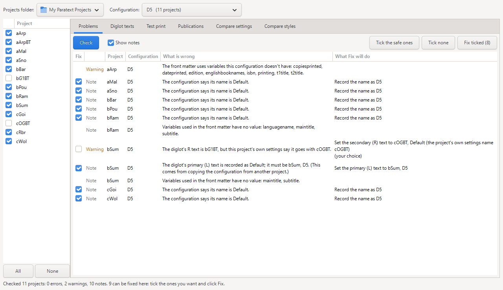
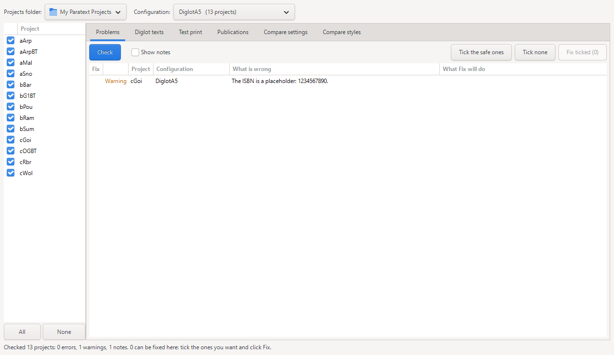
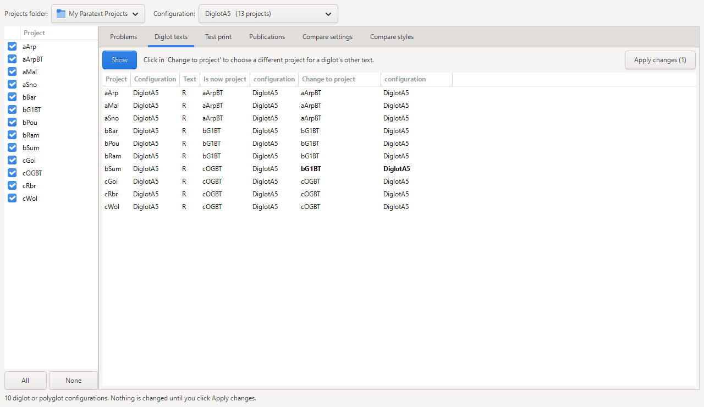
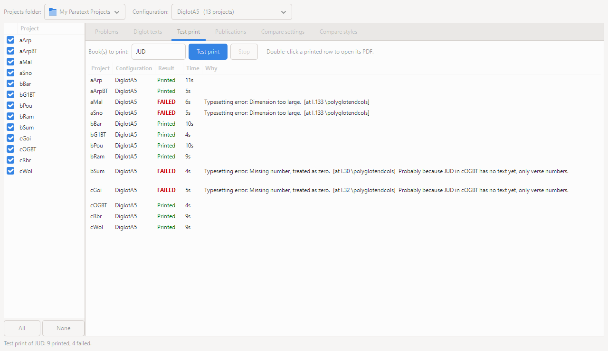
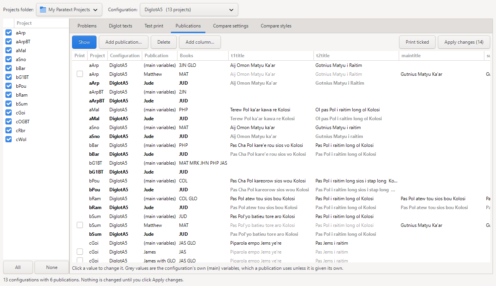
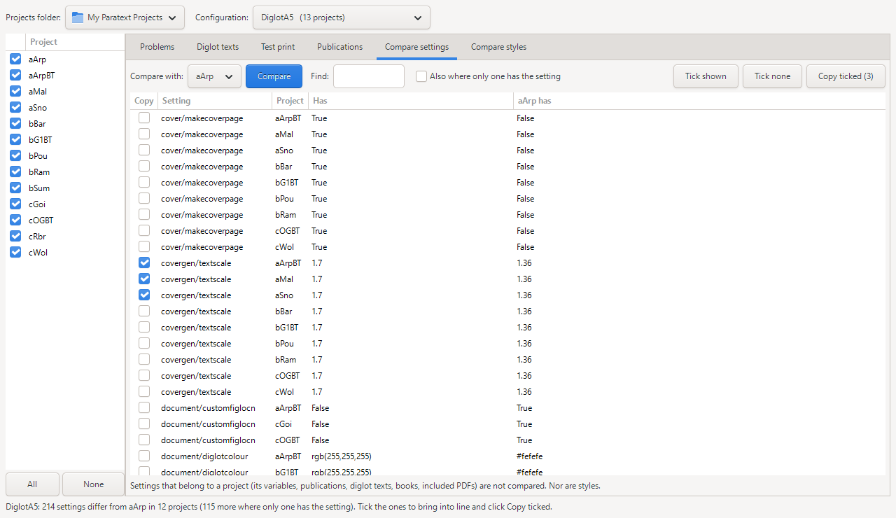
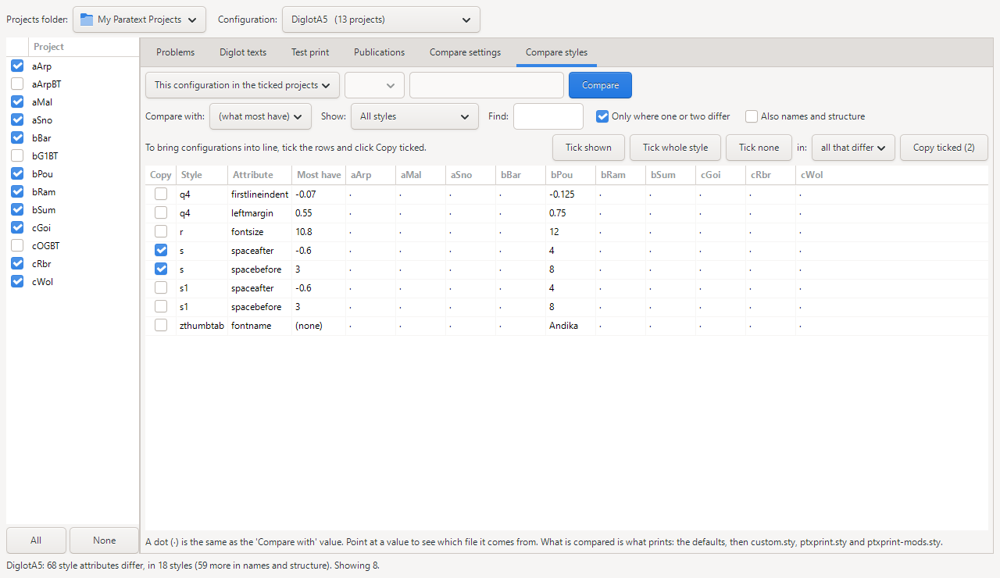
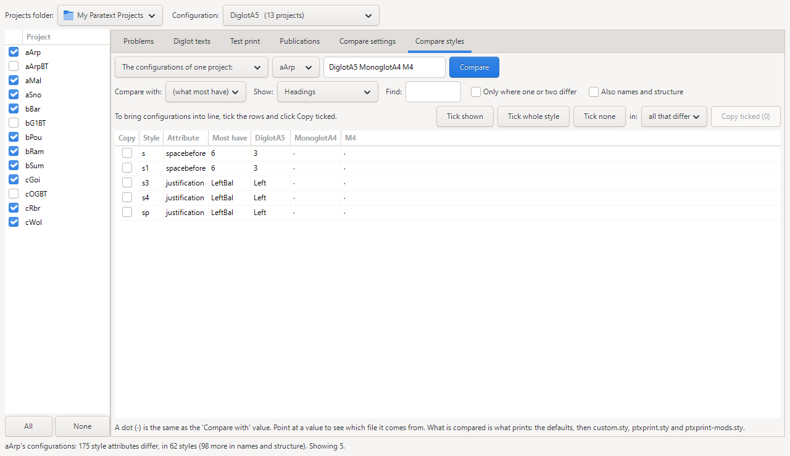

# PTXprint Multi-Project Manager: User Manual

This manual describes the Manager as it is on the `multiproject-manager` branch (November 2026). The pictures were made with a sample set of thirteen projects from Papua New Guinea: ten translations and their three back translations.

## Contents

1. [What the Manager is for](#1-what-the-manager-is-for)
2. [Starting it](#2-starting-it)
3. [The window](#3-the-window)
4. [What it changes, and what it never changes](#4-what-it-changes-and-what-it-never-changes)
5. [Problems: check a configuration everywhere](#5-problems-check-a-configuration-everywhere)
6. [Diglot texts: which project is beside which](#6-diglot-texts-which-project-is-beside-which)
7. [Test print: does it actually print?](#7-test-print-does-it-actually-print)
8. [Publications: titles, ISBNs and books in one table](#8-publications-titles-isbns-and-books-in-one-table)
9. [Compare settings](#9-compare-settings)
10. [Compare styles](#10-compare-styles)
11. [How to do common jobs](#11-how-to-do-common-jobs)
12. [When something goes wrong](#12-when-something-goes-wrong)
13. [Using it from the command line](#13-using-it-from-the-command-line)
14. [Words used in this manual](#14-words-used-in-this-manual)

---

## 1. What the Manager is for

PTXprint works on one project at a time. If you look after the same kind of publication in many projects, for example a diglot layout called DiglotA5 in ten languages, you have ten copies of that configuration, and they drift apart. One has the wrong back translation beside it. Another still has last month's title. A third has section headings spaced differently, and nobody knows why.

The Manager looks at one configuration in every project that has it, all at once. It can:

- **find problems** that would stop a print or print the wrong thing, and repair the ones that are safe to repair;
- **show which project is on the other side** of each diglot, and let you change it;
- **print a test book in every project** and tell you which failed and why;
- **keep titles, ISBNs and book lists** for every project in one table;
- **show where one project's settings or styles differ** from the others, and bring them into line.

It does not replace PTXprint. You still design a layout, adjust paragraphs and place pictures in PTXprint. The Manager is for keeping many copies of a finished layout working.

## 2. Starting it

**From the Start menu.** When it is installed with PTXprint, choose **PTXprint Multi-Project Manager**. Its icon is PTXprint's open book three times over. (It is not in a released installer yet.)

**From the source code.** In the `ptx2pdf` folder:

```
python python/scripts/ptxprint-manager
```

**Choosing the projects folder.** The Manager opens in the projects folder that PTXprint last used. To work somewhere else, click the **Projects folder** button at the top left and choose the folder that contains the projects (not one of the projects themselves).

You can have PTXprint and the Manager open at the same time. See [section 4](#4-what-it-changes-and-what-it-never-changes) for the one thing to be careful about.

## 3. The window



The window has three parts.

**Along the top**

- **Projects folder:** the folder the projects are in.
- **Configuration:** the configuration to work on. The list is in alphabetical order, and each name shows how many projects have a configuration of that name. The first entry, **(all configurations)**, works on every configuration of every ticked project. Some tabs need a single configuration and will say so.

**Down the left: the projects**

Every project in the folder that has at least one PTXprint configuration is listed, with a tick box. When you choose a configuration, the Manager ticks the projects that have it and unticks the rest. Untick a project to leave it out of whatever you do next. **All** and **None** tick or untick everything. Rest the mouse on a project to see the names of its configurations.

**The six tabs**

| Tab | What it does |
|---|---|
| Problems | Checks the configuration and offers repairs |
| Diglot texts | Shows and changes the other project of each diglot |
| Test print | Prints a book in every ticked project |
| Publications | One table of titles, ISBNs and books |
| Compare settings | Differences in settings from a project you choose |
| Compare styles | Differences in styles between projects or configurations |

**Along the bottom** is a line that says what just happened: how many problems were found, how many changes were made, how many prints failed.

**Nothing happens until you click.** Choosing a configuration or ticking a project only chooses what to work on. Each tab has its own button (**Check**, **Show**, **Test print**, **Compare**) that does the looking.

## 4. What it changes, and what it never changes

The Manager is built so that looking is always safe, and changing always asks first.

**Looking changes nothing.** Check, Show, Compare and Test print never alter a project's settings.

**Every change is shown to you first.** A change is made only when you click a button that says so (**Fix ticked**, **Apply changes**, **Copy ticked**). Each of those then shows a list of exactly what will be changed and waits for **OK**.

**What each button writes:**

| Button | Tab | What it changes in the project |
|---|---|---|
| Fix ticked | Problems | The configuration's settings file (`ptxprint.cfg`). One repair deletes an out-of-date cover PDF |
| Apply changes | Diglot texts | `ptxprint.cfg`: which project and configuration is on that side |
| Test print | Test print | Nothing shared. It writes the PDF, and working files, in the project's `local\ptxprint` folder |
| Apply changes | Publications | `ptxprint.cfg`: variables and publications |
| Copy ticked | Compare settings | `ptxprint.cfg`: the settings you ticked |
| Copy ticked | Compare styles | The configuration's style sheet (`ptxprint.sty`) and nothing else |

**There is no Undo button.** The changes are ordinary changes to the project's files, so they travel with Send/Receive like any other, and the project's history can take them back. Before a style is changed, the Manager also keeps a copy of the style sheet as it was (see [section 10](#10-compare-styles)).

**One thing to be careful about.** If a project's configuration is open in PTXprint while the Manager changes it, PTXprint does not know. When PTXprint next saves, it writes its own older copy over the Manager's change. So after changing a configuration in the Manager, switch to another configuration and back in PTXprint (or close and reopen it) before you carry on working there.

## 5. Problems: check a configuration everywhere

**What this tab is for.** Finding the things that stop a print, or print the wrong thing, before you find them the hard way.

**How to use it**

1. Choose the configuration at the top.
2. Click **Check**.
3. Read the list. Each row is one problem in one project.
4. Tick the repairs you want (the safe ones are ticked for you) and click **Fix ticked**.
5. Read the list of changes it shows you, and click **OK**.

The Manager checks again afterwards, so what is left in the list is what still needs you.

**Reading a row**

| Column | Meaning |
|---|---|
| Fix | A tick box, if the Manager can repair this |
| (colour word) | **Error**: this will stop the print or print the wrong thing. **Warning**: probably not what you want. **Note**: worth knowing |
| Project, Configuration | Where the problem is |
| What is wrong | The problem, in words |
| What Fix will do | Exactly what will be changed if you tick it |

**Safe repairs and "your choice".** A repair with only one right answer is ticked for you. A repair that involves a decision says **(your choice)** and is left unticked. In the picture above, the Manager can see that bSum's diglot has bG1BT on its other side while the project's own settings name cOGBT, but only you know which is right.

**Buttons**

- **Check:** look for problems in the ticked projects.
- **Show notes:** also list the Notes that have no repair. They are hidden to begin with so that the list is short. (A Note that can be repaired is always shown.)
- **Tick the safe ones / Tick none:** tick every safe repair, or untick everything.
- **Fix ticked (n):** make the n ticked repairs, after showing them to you.

**What it looks for**

*In a diglot or polyglot*

- **The primary (L) text is recorded as another project.** This happens when a configuration is copied from another project by an older PTXprint. Safe repair.
- **The secondary (R) text is a project that is not in the folder,** or is this same project. Error. A repair is offered if the project's own settings say which project it goes with; it is your choice.
- **The secondary text uses a configuration that project does not have.** Error. The Manager offers the configuration of the same name, if there is one; your choice.
- **The secondary text is not the project this project's own settings name.** Warning, with a repair that is your choice.
- **The layout does not match the texts** (for example the layout names a text C that is not there). Error; mend it in PTXprint.
- **The diglot is in the format used before PTXprint 2.7.** Warning. Open it in PTXprint and save it.

*Files the configuration uses*

- **A script, an included PDF, a Bible module, a watermark or a pictures folder that is switched on but cannot be found.** The Manager only reports files that are in use; a path left over in a setting that is switched off is ignored. If the file is at a location on one particular computer (such as `C:\0 Paratext Pics`), it is a Warning and says so, because it may be there on someone else's machine.
- For a script, a safe repair is offered when the project has its own copy in its `shared` folder, or when the file is in another project and a past version of PTXprint recorded the path wrongly.

*Variables and the front matter*

- **The front matter uses a variable the configuration does not have.** That text prints blank. If the front matter asks for `maintitle` and `subtitle` and the configuration has `t1title` and `t2title` instead, the Manager says so. No repair is offered: either add the variables, or change the front matter, in PTXprint.
- **A variable the front matter uses is empty** (Note).
- **The ISBN is a placeholder** such as `1234567890`.

*Other things*

- **The book last chosen is not in the project,** or not in the diglot's other project.
- **The book last chosen has no text yet in the diglot's other project:** the book has been created there, with its verse numbers, but not translated. Error. A diglot cannot be typeset with one side empty; the typesetting stops with an error such as *Missing number*. Print a different book, or wait for the back translation.
- **Make Cover Page is off but an old cover PDF is still there,** which the preview would show as if it were new. The repair deletes the old cover file.
- **The configuration records a different project or name from its own** (Note, safe repair). This is harmless and comes from copying.



**What it cannot tell you.** The Problems tab reads the settings; it does not typeset anything. A configuration with nothing wrong here can still fail in the typesetting. That is what **Test print** is for.

## 6. Diglot texts: which project is beside which

**What this tab is for.** Seeing, in one list, which project and configuration each diglot is printed beside, and changing it.

When a diglot configuration is copied from one project to another, the copy still has the first project's back translation beside it. PTXprint cannot know which back translation the new project uses. This tab is where you put that right for many projects at once.



**How to use it**

1. Choose the configuration and click **Show**.
2. There is one row for each other text of each diglot: **R** for a diglot, and **A**, **B** and so on for a polyglot. (The primary text, **L**, is always the project itself, so it is not listed.)
3. To change one, click in its **Change to project** cell and choose a project from the list.
4. The Manager chooses a configuration of that project for you: the one with the same name as before, if it has it. To use a different one, click in the **configuration** cell next to it.
5. Rows you have changed turn **bold**. Nothing has been written yet.
6. Click **Apply changes (n)**, read the list, and click **OK**.

**Reading a row**

- **Is now project / configuration:** what the diglot uses now. The project name is red if there is no such project in the folder.
- **Change to project / configuration:** what it will use after you apply.
- The last column says if something is wrong: the project is missing, it has no configuration of that name, or the project's own settings name a different project.

**Things it will not let you do.** A diglot cannot have the same project on both sides, and the primary (L) text cannot be changed here.

**If nothing is listed,** none of the ticked projects' configurations is a diglot.

## 7. Test print: does it actually print?

**What this tab is for.** Printing one book with the chosen configuration in every ticked project, to see which work.

This is the real test. PTXprint itself does the printing, exactly as it would if you opened each project and clicked Print, including running the configuration's script if it has one.



**How to use it**

1. Choose the configuration, and tick the projects.
2. Type the book in **Book(s) to print**, using its three-letter code, for example `3JN`.
3. Click **Test print**.
4. Watch the **Result** column fill in.

**Choosing the book**

- **A short book is quickest.** 3 John or Jude takes about ten seconds a project, so thirteen projects are done in under a minute.
- **Several books** separated by spaces, for example `JAS GLO`, are printed together as one PDF, which is how to test a book with its glossary.
- **Different books find different problems.** In the picture above, every project printed 3 John, but Jude failed in four. Try the books you are about to publish.

**Reading the results**

| Result | Meaning |
|---|---|
| Waiting | In the queue. Three are printed at a time |
| Printing... | PTXprint is working on it |
| **Printed** (green) | A PDF was made. Double-click the row to open it |
| **FAILED** (red) | No PDF. The **Why** column gives the reason |
| Not tried | The project does not have that book, so nothing was run |
| Stopped | You clicked **Stop** |

**The Why column** shows what PTXprint said, or the first error from the typesetting. Some you can act on yourself:

- *Diglot project or configuration not found: R is project ...* Put it right on the **Diglot texts** tab.
- *These books are not available in the secondary diglot project.* The other project does not have that book.

- *Probably because JUD in cOGBT has no text yet, only verse numbers.* The Manager adds this when a diglot fails and it can see that the other project's copy of the book is empty. In the picture, that is why bSum and cGoi failed: their back translation, cOGBT, has Jude's verse numbers but no words.

Others come from deep inside the typesetting, for example *Typesetting error: Dimension too large. [at l.133 \polyglotendcols]*. These are worth sending to PTXprint support, with the project, the configuration and the book: that is everything they need to reproduce it.

**What "Printed" does and does not mean.** It means PTXprint produced a PDF without an error. It does not mean the pages are right. A diglot with the wrong back translation beside it prints perfectly well. Open a few of the PDFs and look.

**What a test print writes**

- The PDF goes where PTXprint always puts it: the project's `local\ptxprint` folder, with the usual name. If you already had a PDF of that book from that configuration, the test print replaces it.
- Nothing in the project's shared settings is touched. A normal print in PTXprint tidies and re-saves the style sheet, picture list and adjust lists; a test print does not, so it leaves nothing for Send/Receive.

**Stop** ends the prints that are running and cancels the rest.

**Printing with (all configurations)** prints the book with every configuration of every ticked project. The Manager asks first if that is more than thirty prints.

## 8. Publications: titles, ISBNs and books in one table

**What this tab is for.** Keeping the things that belong to a particular book, its titles, ISBN and which books it contains, for every project, in one place.

**Why it is needed.** A configuration such as DiglotA5 is used for many books. Its variables hold the title and ISBN of whichever book was printed last, so it is easy to print James with the title of Colossians. A **publication** fixes that: it is a named set of books with its own values for those variables. PTXprint has had publications since version 3.1; this tab lets you see and edit them across projects.



**Reading the table**

Each configuration has one row called **(main variables)**, followed by a row for each of its publications.

- **(main variables)** is what the configuration's own variables are now: what you see on the Peripherals tab in PTXprint. Its **Books** cell shows the book last chosen in PTXprint, and cannot be changed here.
- **A publication row** shows the publication's name, its books, and its values.
- **A grey value** is not the publication's own. It is the main value showing through, which is what the publication will use.
- **A black value** in a publication row is the publication's own.

The columns are the title variables and ISBN that are in use, and any other variable that some publication has its own value for.

**Changing a value.** Click it, type, and press Enter. Typing over a grey value gives that publication its own value. Changing a **(main variables)** value changes the configuration's own variable.

**Buttons**

- **Show:** read the publications of the ticked projects. If you have changes waiting, it asks before forgetting them.
- **Add publication...:** asks for a name and the books, and adds that publication to **every ticked project's configuration** that does not already have one of that name. The new rows start with the main values in grey, ready for you to type each project's own titles.
- **Delete:** marks the highlighted publication rows to be deleted. Click a row first; hold Ctrl or Shift to highlight several. Clicking **Delete** again on a marked row changes its mind.
- **Add column...:** shows another variable as a column (for example `dateprinted`), so that publications can have their own value of it.
- **Print ticked:** prints the publications ticked in the **Print** column, each with its own books and values. The results appear on the **Test print** tab. Apply your changes first; the Manager will remind you.
- **Apply changes (n):** write everything that is waiting, after showing you the list.

Rows with changes waiting are **bold**, and the last column says **new** or **will be deleted**.

**Publication names.** The name becomes part of the PDF's file name (for example `cGoi_DiglotA5_James_ptxp.pdf`), so it cannot contain `\ / : * ? " < > |`.

**Books** are given as PTXprint book codes: `JAS`, or `JAS GLO`, or a range such as `MAT-JHN`.

**One thing the Manager does for you.** PTXprint only keeps a publication's own value of a variable if that variable is marked, on the Peripherals tab, as one that differs between publications. When you give a publication its own value here, the Manager marks the variable for you.

**How this fits with PTXprint.** In PTXprint, printing a publication from its Publications tab copies that publication's books and values into the main variables, and they stay there. That is deliberate. So after printing a publication in PTXprint, the **(main variables)** row here will show that publication's values.

## 9. Compare settings

**What this tab is for.** Seeing where the chosen configuration differs, setting by setting, between one project you trust and the others, and copying settings across.



**How to use it**

1. Choose one configuration at the top (not "all configurations").
2. In **Compare with**, choose the project to compare the others with. This is the *reference*: the one whose values you would copy.
3. Click **Compare**.
4. Each row is one setting in one project that differs from the reference. **Has** is what that project has; the last column is what the reference has.
5. Tick the rows you want brought into line and click **Copy ticked (n)**. Read the list and click **OK**.

Nothing is ticked for you. Every row here is a judgement: the difference may be a mistake, or it may be deliberate.

**Finding what you want**

- **Find:** type part of a setting's name, a project's name or a value, and only rows containing it are shown. For example `margin`, or `bPou`.
- **Tick shown:** ticks every row now showing. Use it with Find: find `covergen/textscale`, then Tick shown.
- **Tick none:** unticks everything.
- **Also where only one has the setting:** see below.

**Setting names.** Settings are shown as they are stored, for example `paper/margins` or `document/diglotlayout`. The first part is the group; the second is the setting. Most can be recognised from the name. If you cannot tell what one is, leave it alone.

**"(not set)" and the tick box for it.** A configuration last saved by an older PTXprint does not have the settings that were added later. PTXprint uses its built-in value for them, which is usually the same as what a newer configuration has written down. These rows would bury the real differences, so they are hidden unless you tick **Also where only one has the setting**. Copying such a row writes the reference's value into the other project, or removes the setting if the reference does not have it.

**What is not compared.** Settings that belong to a project or a publication are left out, because they are meant to differ: variables, publications, which projects a diglot uses, each text's column width, the book last chosen, copyright and licence, included PDFs and the watermark, the Bible module, and Cover Wizard choices. Styles are not compared here either; they have their own tab.

**After copying,** run a test print. A setting such as a margin or a font size changes every page.

## 10. Compare styles

**What this tab is for.** Finding out why the same configuration looks different in two projects, when the answer is in the styles; and bringing the styles into line.

A configuration has hundreds of styles (`\p`, `\s`, `\q1`, `\f` and so on), each with a dozen or more attributes. This tab does not show all of them. It shows only the attributes that are **not the same everywhere**.



**Two ways to compare**

The first box on the tab chooses between them.

- **This configuration in the ticked projects.** The columns are projects. Use it to find the project that is out of step.
- **The configurations of one project.** Choose the project in the next box, and type the configuration names, with spaces between them, in the box after that. The columns are configurations. Use it to see how, say, DiglotA5 and MonoglotA4 differ in one project.

Then click **Compare**.

**Reading the grid**

Each row is one attribute of one style. In the picture above, the row `s  spacebefore` reads: for the section heading style `\s`, most projects have 3 as the space before; bPou has 8.

- **Style** and **Attribute** say which value the row is about.
- **Most have** is the value they are compared with.
- Then there is a column for each project (or configuration). A **dot** means "the same as the compared-with value". Anything else is that project's own value.

So a column with dots all the way down is in step, and the one with values in it is the one to look at.

**Compare with.** To begin with, each row is compared with **what most have**. Choose a project in **Compare with** to compare against that one instead; the third column then says "aArp has", and the dots mean "same as aArp".

**Narrowing it down**

- **Show:** only one group of styles: Text, Headings, Notes, Introductions, Cover, or Sidebars and categories.
- **Find:** part of a style's or attribute's name, for example `fontsize` or `q1`.
- **Only where one or two differ:** hides rows where the projects split into large groups, and leaves the strays. This is the quickest way to find a project that is out of step.
- **Also names and structure:** also shows attributes that do not change how a page looks, such as a style's name, description, and where it may occur. These are hidden to begin with.

**A useful habit.** The back translation projects usually have different styles from the translations, as a group. Untick them on the left before comparing, as in the picture, and the list is much shorter.

**Where a value comes from.** Rest the mouse on a value and the Manager says which file sets it. A style's value comes from the last of these that gives one:

1. PTXprint's built-in defaults;
2. the project's `custom.sty`, if the configuration is set to use it;
3. the configuration's `ptxprint.sty`, which is what PTXprint's Styles tab saves;
4. the configuration's `ptxprint-mods.sty`, if the configuration is set to use it.

When two projects differ and one of them has a `custom.sty` the other lacks, that is usually the answer.

**What counts as the same.** The Manager compares what prints, not how it is written. `12` and `12.0` are the same. A colour written as a single number and the same colour written in hexadecimal are the same. A margin that is not given and a margin of 0 are the same. For a paragraph style, bold that is not mentioned and bold that is turned off are the same.



### Copying style values

1. Tick the rows you want brought into line. Nothing is ticked for you.
2. In the **in:** box, leave **all that differ**, or choose one project to change only that one.
3. Click **Copy ticked (n)**. The number is how many values will change.
4. Read the list, which shows each value and what it becomes, and click **OK**.

Each project that differs in a ticked row is given the compared-with value: what most have, or the reference's if you chose one.

**Buttons for ticking**

- **Tick shown:** ticks the rows showing, **except fonts and cover styles**. Those are often a project's or a publication's own, so tick them yourself if you mean it.
- **Tick whole style:** click on any row of a style first, then this ticks every row showing for that style.
- **Tick none:** unticks everything.

**What copying does to the files**

- Only the configuration's `ptxprint.sty` is changed, and only the attributes you ticked. `custom.sty` and `ptxprint-mods.sty` are never written.
- Where the wanted value is what the style would have anyway, the Manager removes the line that says otherwise, instead of writing a value.
- Before a style sheet is changed, a copy of it as it was is kept in the project's `local\ptxprint\<configuration>` folder, named `ptxprint.sty.before-copy`. That folder is not shared by Send/Receive. Each copy replaces the one before, so it holds the sheet as it was before the most recent Copy.

**When a value will not change.** If a project's `ptxprint-mods.sty` sets the value, it wins, because it is read after `ptxprint.sty`. The Manager copies the value, checks again, and tells you in the line at the bottom: *is still 9, because its ptxprint-mods.sty sets it*. To change it you must edit `ptxprint-mods.sty` yourself.

**After copying,** run a test print and look at the pages. A style change can move every page of a book.

**In a diglot,** each project's styles are the ones for its own text. The other column of a diglot is styled by the back translation project's style sheet. If the right-hand column looks different between two diglots, compare the back translation projects.

## 11. How to do common jobs

### Set up a diglot configuration in a new project

1. In PTXprint, open the project that has the working configuration and copy the configuration to the new project.
2. In the Manager, choose the configuration and open **Diglot texts**. Click **Show**, set the new project's **R** row to its own back translation, and **Apply changes**.
3. Open **Problems**, click **Check**, and **Fix ticked**.
4. Open **Test print**, type a short book, and click **Test print**.
5. Open **Publications** and fill in the new project's titles.

### Find out why one project's pages look different

1. Choose the configuration. Untick the back translation projects.
2. Open **Compare styles**, click **Compare**, and tick **Only where one or two differ**.
3. Look for the column that has values where the others have dots.
4. If nothing shows, open **Compare settings**, choose a project that looks right in **Compare with**, and click **Compare**. Use **Find** with the odd project's name.

### Get ready to print the same book in every project

1. Open **Publications** and click **Show**.
2. Click **Add publication...**, and give it a name (for example `James`) and its books (`JAS GLO`).
3. Type each project's title in its new row, and its ISBN.
4. Click **Apply changes**.
5. Tick the new rows in the **Print** column and click **Print ticked**.
6. On the **Test print** tab, double-click each **Printed** row and look at the PDF.

### Check that nothing has broken after a change

1. Choose the configuration.
2. **Problems**: **Check**. Deal with any Errors.
3. **Test print**: print a short book, then one of the books you are working on.

This takes a couple of minutes for a dozen projects. It is worth doing after updating PTXprint, after Send/Receive brings in other people's changes, and before a print run.

### Make one project's settings the standard

1. Decide which project is right. Test print it and look at it.
2. **Compare settings**: choose it in **Compare with**, and **Compare**.
3. Work through the list a setting at a time: use **Find** for a setting's name, decide, and **Tick shown** if the others should match.
4. **Copy ticked**.
5. **Compare styles**: choose the same project in **Compare with**, and do the same.
6. **Test print**.

## 12. When something goes wrong

**The project I want is not in the list.** Only projects with at least one PTXprint configuration are listed. Check that **Projects folder** is the folder that contains the projects.

**The configuration I want is not in the list.** The list holds every configuration name found in the folder. If it is not there, no project in this folder has it.

**The tab says "Choose one configuration".** Compare settings, and the first way of comparing styles, need a single configuration, not **(all configurations)**.

**Check finds nothing, but printing fails.** The Problems tab reads settings; it cannot see problems in the text or in the typesetting. Use **Test print**, and read the **Why** column.

**A test print says FAILED with a typesetting error.** If the Why column ends with "Probably because ... has no text yet", that is the reason: the other project's book is empty. Otherwise, try a different book: if other books print, the problem is in that book's text or its pairing with the other project's text. Try the same book in a project that works, with the same back translation: if that prints, compare the two projects on **Compare settings** and **Compare styles**. If you cannot find it, send PTXprint support the project name, configuration, book, and the text from the Why column.

**A test print says "Not tried".** The project does not have a file for that book.

**Every test print fails at once, with "PTXprint could not be started".** The Manager could not find PTXprint beside itself. Reinstall, or run both from the same source folder.

**I changed something in the Manager and PTXprint changed it back.** The configuration was open in PTXprint, which then saved its own copy. See [section 4](#4-what-it-changes-and-what-it-never-changes).

**I copied a style value and it did not change.** Read the line at the bottom of the window. It names the file that is overriding it, which will be `ptxprint-mods.sty`.

**I want to take a change back.** For a style, the sheet as it was before the last Copy is in `local\ptxprint\<configuration>\ptxprint.sty.before-copy`. For anything else, use the project's Send/Receive history, or put the old value back by hand in PTXprint.

**The grid has too many rows to be useful.** Untick the back translation projects, choose a group in **Show**, and tick **Only where one or two differ**.

## 13. Using it from the command line

Everything the window does can also be done from a command line, which is useful for a quick check or for a script. Give the projects folder with `-p`; without it, the folder PTXprint last used is taken.

```
ptxprint-manager -p "C:\My Paratext Projects" validate -c DiglotA5
```

| Command | What it does |
|---|---|
| `validate -c NAME` | List the problems. Changes nothing |
| `validate -c NAME --fix` | Ask about each repair in turn |
| `validate -c NAME --fix --yes` | Make the safe repairs without asking. Repairs that are "your choice" are left |
| `secondary -c NAME` | List each diglot's other project |
| `secondary -c NAME -P PROJECT --to OTHER` | Set that project's R text to OTHER |
| `testprint -c NAME -b BOOK` | Test print BOOK (default `3JN`) in every project |
| `publications -c NAME` | List variables and publications |
| `compare -c NAME --ref PROJECT` | List settings that differ from PROJECT's |
| `compare -c NAME --ref PROJECT --copy GROUP/SETTING` | Copy that setting from PROJECT, after asking |
| `styles -c NAME` | List style attributes that differ between projects |
| `styles -c NAME --strays` | Only where one or two differ |
| `styles --within PROJECT -c A -c B` | Compare configurations A and B of one project |

Add `-P` with project names, separated by commas, to work on only those projects: `-P aArp,aMal,aSno`. Add `-q` to `validate` to leave out the Notes.

`validate` and `testprint` finish with a result that a script can test: 0 if there were no errors or failures, 1 if there were.

Publications can be listed but not edited from the command line, and style values can be compared but not copied. Use the window for those.

## 14. Words used in this manual

**Adjust list.** PTXprint's record of paragraphs you have shrunk or stretched to make pages fit.

**Back translation (BT).** A project holding a translation of the vernacular text into a major language. In these diglots it is the other text.

**Configuration.** A named set of PTXprint settings in a project, such as DiglotA5. It is a folder inside the project's `shared\ptxprint` folder.

**Diglot.** A publication with two texts side by side. A **polyglot** has more than two.

**Primary text (L).** The diglot's main text: always the project the configuration belongs to.

**Publication.** A named set of books within a configuration, with its own values for some variables, such as the title and ISBN.

**Reference.** On the compare tabs, the project (or configuration) the others are compared with, and whose values are copied.

**Secondary text (R).** The diglot's other text: another project and one of its configurations.

**Send/Receive.** Paratext's way of sharing a project. It carries everything in the project's `shared` folder, including PTXprint configurations, and nothing in `local`.

**Style sheet.** The file that says how each marker is printed. A configuration's own is `ptxprint.sty`.

**Variable.** A named piece of text, such as `t1title` or `isbn`, that the front matter and cover put on the page. They are on PTXprint's Peripherals tab.
